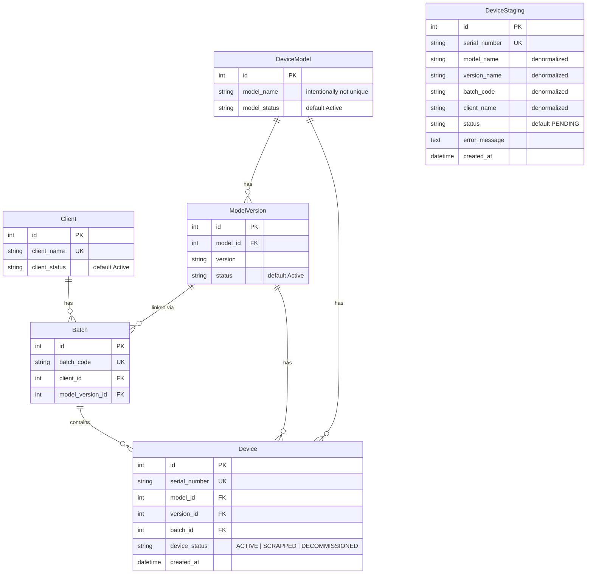

# Entity Relationship Diagram

This diagram reflects the current Django models in `backend/warehouse`.

## Notes

- **DeviceStaging** intentionally avoids foreign keys during scan/validation; confirmed devices are promoted to **Device** with proper FK relationships.
- **Client**, **DeviceModel**, and **ModelVersion** use status fields instead of hard deletes to preserve audit history.
- **Batch** ties a client to a model version under a unique `batch_code`.
- **DeviceModel.model_name** is intentionally not unique — the same model name can exist across different clients; uniqueness is enforced at the `ModelVersion` level via `unique_together (model, version)`.