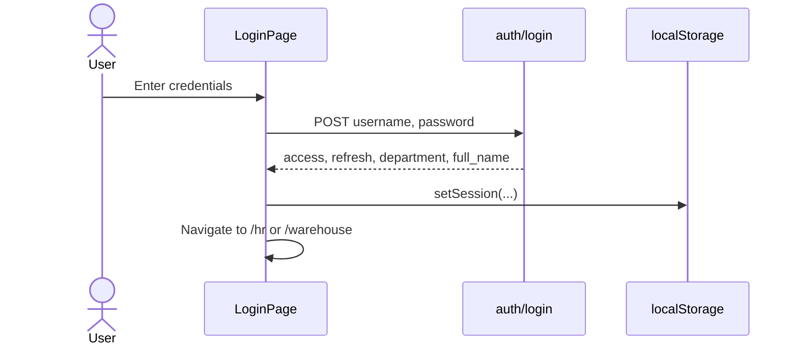
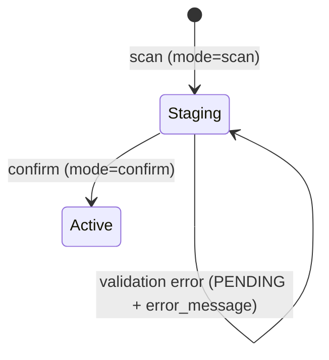

# Workflows and User Journeys

## Authentication flow



| Department | Dashboard route |
|------------|-----------------|
| `warehouse` | `/warehouse` |

If a user hits a route for another department, they are redirected to `/unauthorized`. Expired or invalid tokens clear the session and send the user back to `/login`.

## Warehouse: Client onboarding (bulk workflow)

**UI:** `WarehousePage`  
**API:** `POST warehouse/clients/`  
**Permission:** `IsWarehouseAgent` (enforced for both steps)

The client workflow is a two-step process controlled by `mode` and `step`:

### Step 1 — Base (`step: "base"`)

Creates clients and device models.

| Mode | Behavior |
|------|----------|
| `bulk_clients` | Array of client & model pairs in `clients[]` |

Wrapped in `transaction.atomic` — if any client/model pair fails validation, the entire batch is rolled back (no partial writes).

**Response:**
```json
{
  "clients": [{"id": 1, "name": "..."}],
  "models": [{"id": 1, "name": "..."}]
}
```

After successful bulk submission, response refreshes dropdown data for clients and models, and the linking section is unlocked.

### Step 2 — Linking (`step: "linking"`)

Associates `batch_codes` with clients and `device_model` with `model_versions`.

| Mode | Behavior |
|------|----------|
| `bulk_clients` | Array of links in `links[]` |

Wrapped in `transaction.atomic` — if any link fails validation, the entire batch is rolled back (no partial writes).

**Response:**
```json
{
  "links": [{"batch_code": "...", "client_id": 1, "model_version_id": 1}]
}
```

After successful linking, the device scanning section is unlocked.

## Warehouse: Device intake

**UI:** Device scan/confirm within warehouse workflow  
**API:** `POST warehouse/devices/`



### Scan (`mode: "scan"`)

1. Warehouse agent scans or enters a serial number.
2. `DeviceService.scan_device` validates against client/model/batch data.
3. A **DeviceStaging** row is created with denormalized names and `status=PENDING` (or error details if invalid).

### Confirm (`mode: "confirm"`)

1. Agent confirms a staged serial number.
2. `DeviceService.confirm_device` promotes the record to a **Device** with foreign keys to model, version, and batch.
3. Device status is set to `ACTIVE`.

Staging uses plain text fields (no FKs) so validation can run before committing relational data.

## API documentation workflow (developers)

1. Start Django: `python manage.py runserver`
2. Open Swagger UI at `/api/docs/`
3. Authenticate using a JWT from `auth/login/` (Bearer token) to try protected endpoints

Schema is generated from DRF views via **drf-spectacular** (`/api/schema/`).


